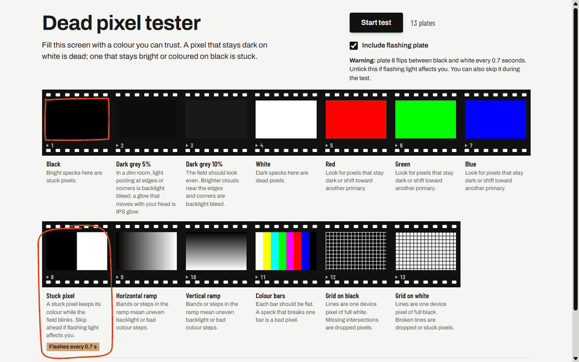

# Dead pixel tester

A full-screen monitor check for dead, stuck, and uneven pixels. The page fills the display with a colour or pattern you can trust, then gets the controls out of the way.

Live demo: [deadpixel-tester.vercel.app](https://deadpixel-tester.vercel.app/)



## What it shows

1. Solid plates: black, white, red, green, blue
2. A slow black/white blink, so a stuck pixel keeps its colour while the field changes
3. Horizontal and vertical black-to-white ramps
4. Colour bars: white, yellow, cyan, green, magenta, red, blue, black
5. A fine grid on black and on white, drawn so each line is exactly one device pixel at full intensity

A pixel that stays dark on white is dead. A pixel that stays bright on black, or keeps one colour through the blink, is stuck. Bands in a ramp are uneven backlight or bad colour steps.

The blink flips between black and white every 0.7 seconds. The intro screen warns about it before you start and has an **Include flashing plate** checkbox. It is ticked by default unless your system asks for reduced motion. During the test, **Skip flashing** in the control bar drops it. With reduced motion on, the blink becomes a still black/white split instead of flashing.

## Controls

- **Start test** fills the screen, using the browser full-screen API when it is allowed
- Click (primary button) or tap the plate for the next pattern. Right and middle clicks do nothing
- Swipe left for the next plate, swipe right for the previous one
- Arrow keys move, Space advances, F toggles full screen
- Esc leaves full screen; press Esc again to stop the test
- Move the mouse, or on a touch screen tap near the top or bottom edge, to bring the control bar and plate label back. They hide so they do not cover the pixels you are checking, and a small bump of the mouse does not bring them back

On a phone the stage is the full viewport even when the browser will not enter full screen.

## Run it locally

```bash
npm install
npm start
```

`npm start` opens the Vite dev server. `npm run build` writes `build/`, which is the directory Vercel already publishes.

## Checks

```bash
npm run lint      # ESLint
npm test          # unit tests (Vitest + Testing Library)
npm run test:e2e  # browser smoke test against `vite preview` (Playwright)
```

The end-to-end test needs a Playwright Chromium build. Run `npx playwright install chromium` once, or point `PLAYWRIGHT_CHROMIUM_PATH` at an existing Chromium binary. CI runs lint, unit tests, and the build on every push and pull request.
